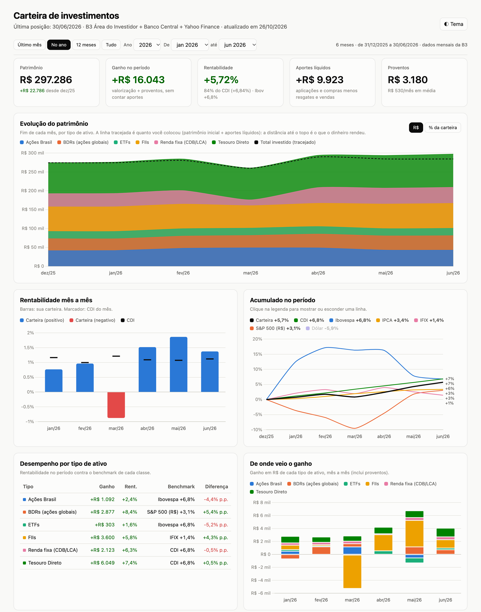

# Carteira B3

Dashboard local da sua carteira a partir dos **relatórios consolidados mensais da B3** (Área do Investidor). Mostra patrimônio, aportes, rentabilidade mês a mês contra CDI/Ibovespa/IPCA/IFIX/S&P 500, composição, proventos e movimentações, com seleção de período.

<picture>
  <source media="(prefers-color-scheme: dark)" srcset="docs/dashboard-dark.png">
  
</picture>

<sub>Carteira fictícia gerada por <code>scripts/exemplo.py</code>.</sub>

Tudo roda na sua máquina: as planilhas, os dados normalizados e o dashboard gerado ficam fora do git.

## Requisitos

- Python 3.9+
- Navegador (o dashboard é um HTML estático; Chart.js vem de CDN)

```sh
python3 -m venv .venv && .venv/bin/pip install -r requirements.txt
```

## Experimente sem dados reais

```sh
.venv/bin/python scripts/exemplo.py
open exemplo/relatorios/dashboard.html
```

Gera uma carteira fictícia no layout da B3 em `exemplo/` e roda o pipeline completo nela.

## Uso mensal

1. Na [Área do Investidor da B3](https://www.investidor.b3.com.br), baixe o **relatório consolidado mensal em .xlsx** de cada mês. Opcional: o anual do ano anterior, que serve como posição inicial.
2. Rode a skill `atualizar-carteira` (`/atualizar-carteira` no Claude Code; também funciona no Cursor e no Codex). Para rodar manualmente:

```sh
.venv/bin/python scripts/importar.py      # ~/Downloads -> dados/b3 (move) + dados/mensal (normaliza)
.venv/bin/python scripts/gerar.py         # dados/mensal -> relatorios/data.js
open relatorios/dashboard.html
```

`importar.py --simular` mostra o que seria feito sem mover nada; `--origem <pasta>` lê de outra pasta que não Downloads.

## Diagnóstico e carteira ideal

O **diagnóstico do período** explica a diferença entre a carteira e o CDI. Para cada tipo de ativo:
- **alocação** = peso × (índice da classe − CDI): o efeito do mercado em que você está;
- **seleção** = peso × (rentabilidade da classe − índice): o efeito das suas escolhas.

O **benchmark composto** é a média dos índices de cada classe, ponderada pelos seus pesos. É a régua justa para uma carteira diversificada (o Ibovespa só mede ações brasileiras).

Abaixo disso aparecem insights automáticos:
- câmbio sobre os BDRs;
- proventos que não cobriram a queda de preço;
- posições pequenas demais para fazer diferença, com o que fazer em cada caso;
- concentração por setor: dentro de cada classe, papel × tijolo nos FIIs e temas espalhados entre classes (por exemplo, financeiro em ações e BDRs).

Os setores vêm de `scripts/setores.py`, uma lista genérica de ativos da B3. Para classificar um ativo que falta ou corrigir um setor, use `dados/setores.json` no formato `{"TICKER": "Setor"}`.

A **carteira ideal** fica em `dados/alvo.json` (fora do git). O jeito mais fácil de montar é pelo botão **Editar alvo** no dashboard:
- começa pela composição atual;
- permite editar o % de cada classe e de cada ativo, adicionar e remover ativos;
- tem atalhos para igualar os pesos, usar a composição atual e zerar os ativos abaixo de 1% da carteira.

O rascunho fica no navegador e já vale para as sugestões. Para salvar:

```sh
# no dashboard: Exportar alvo.json (vai para ~/Downloads)
.venv/bin/python scripts/alvo.py --importar   # valida e move para dados/alvo.json (o anterior vira alvo.anterior.json)
.venv/bin/python scripts/gerar.py
```

`scripts/alvo.py` sem argumentos cria o alvo a partir da composição atual, para editar à mão.

```json
{
  "aporte_mensal": 5000,
  "classes": {
    "Ações Brasil": {"alvo": 30, "ativos": {"PETR4": 20, "VALE3": 25, "ITUB4": 30, "WEGE3": 25}},
    "FIIs": {"alvo": 15, "ativos": {"HGLG11": 50, "KNRI11": 30, "XPML11": 20}},
    "Tesouro Direto": {"alvo": 10}
  }
}
```

Como preencher:
- `alvo` é o percentual da classe na carteira, e as classes somam 100.
- `ativos` é o percentual dentro da classe, e também soma 100.
- Um ativo que você tem mas não aparece em `ativos` tem alvo 0.
- Um ativo listado que você ainda não tem entra como compra.
- Classe sem `ativos` é rebalanceada só no total. Isso é útil na renda fixa, onde você escolhe o título na hora.

O dashboard mostra o desvio de cada classe e de cada ativo, e o que fazer no próximo mês em dois modos:
- **só com aportes:** o aporte vai para o que está abaixo do alvo, sem vender nada;
- **vendendo o excesso:** compra o que falta e vende o que passou do alvo. Lembre do IR antes de vender.

**Regras da política** (opcionais, em `"regras"` no `alvo.json` ou no editor):

| Regra | O que limita |
|---|---|
| `max_ativo` | % de um ativo de renda variável na carteira |
| `max_setor_classe` | % de um setor dentro de Ações Brasil, Exterior ou FIIs |
| `max_setor_carteira` | % de um setor na carteira toda, somando as classes |
| `min_posicao` | % mínimo de uma posição de renda variável |
| `tolerancia_classe` | desvio aceito, em p.p., entre o % atual e o alvo de cada classe |

Para cada regra quebrada, o dashboard mostra quanto vender ou aportar para voltar ao limite. No modo "só com aportes", o que está acima de um limite não recebe aporte. O painel aplica os limites que você definiu; ele não escolhe ativos nem setores.

## Como os números são calculados

- **Patrimônio, posições, preços e proventos:** exatamente os da planilha da B3. O importador confere a soma de cada aba contra o "Total" da B3.
- **Rentabilidade mensal:** Dietz modificado, `ganho / (patrimônio inicial + aportes/2)`, com `ganho = final − inicial − aportes + proventos`. Os períodos encadeiam os meses.
- **Aportes em bolsa:** vêm da aba Negociações e são reconhecidos quando a posição liquida (D+1/D+2).
- **Aportes em CDB/LCA/Tesouro:** a B3 não os informa, então são deduzidos comparando os meses (título novo, título que sumiu, mudança de quantidade). A rentabilidade fica próxima da real, mas não é idêntica ao extrato da corretora.
- **Classes:** seguem o que o ativo carrega, não a aba da B3:
  - BDRs e ETFs de S&P 500 ou globais formam "Exterior (BDRs e ETFs)";
  - ETFs de Ibovespa ou dividendos entram em Ações Brasil;
  - ETFs de títulos públicos entram em Tesouro Direto;
  - ETFs de cripto formam a classe Cripto.
- A menor granularidade é **um mês**, porque a B3 entrega a posição de fim de mês.

## Simulador de alocação

Fica na aba **Simulador** (`dashboard.html#simulador`). Você escolhe o % de cada classe e o dashboard calcula como essa mistura teria se comportado no passado. A simulação usa os índices de cada classe, rebalanceados todo mês:
- Ações Brasil: Ibovespa;
- Exterior: S&P 500 com dividendos, em reais;
- FIIs: IFIX;
- Cripto: Bitcoin em reais, como aproximação (ETFs de cripto costumam seguir cestas, como o Nasdaq Crypto Index, com cerca de 75% de Bitcoin);
- renda fixa, Tesouro e crédito privado: CDI.

Para cada mistura ele mostra:
- retorno ao ano e retorno acima do IPCA;
- volatilidade;
- pior queda e quantos meses levou para recuperar;
- % de meses negativos;
- Sharpe sobre o CDI;
- o crescimento de R$ 100;
- quanto do risco vem de cada classe.

A tabela compara o mix simulado com a composição atual, o alvo e três referências calculadas sobre as classes que você já tem, sem cripto (dar a ela o mesmo peso das outras premiaria quem olha o Bitcoin depois de ele subir):
- **pesos iguais**;
- **60/40** (60% em renda fixa);
- **paridade de risco**, aplicada só entre as classes de renda variável, porque com o CDI junto ele ficaria com quase tudo.

O botão **Aplicar ao alvo** leva os % das classes para o rascunho do editor do alvo e mantém os ativos de cada classe.

A janela pode ser o último mês, o ano atual, 12 meses, um ano específico, 5, 10 ou 15 anos ou o máximo disponível. Abaixo de 12 meses o retorno é o do período (sem anualizar), e volatilidade e Sharpe só aparecem a partir de 3 meses. As séries começam em datas diferentes: a maioria em 2000, o IFIX em 2011 e o Bitcoin em 2014. Por isso, a janela máxima é limitada pela série mais curta entre as classes usadas. Classes com menos de 1% num mix ficam de fora do cálculo, para que uma posição irrelevante não encurte a janela de todos.

Limitações:
- usa índices, não os seus ativos;
- não considera custos nem IR;
- Tesouro IPCA+ a mercado oscila bem mais que o CDI;
- passado não garante futuro, e o simulador não é recomendação.

## Fontes de mercado

| Dado | Fonte |
|---|---|
| CDI, IPCA, Dólar PTAX | [Banco Central, SGS](https://dadosabertos.bcb.gov.br) (oficial, sem autenticação) |
| Ibovespa, S&P 500, IFIX (via ETF XFIX11) | Yahoo Finance |
| Simulador: S&P 500 com dividendos (^SP500TR), Bitcoin | Yahoo Finance |
| Simulador: IFIX oficial desde 2011 | [B3, estatísticas históricas de índices](https://www.b3.com.br) (endpoint público, não documentado) |

> **Aviso:** o endpoint do Yahoo Finance é **não oficial e não documentado**. Pode mudar ou bloquear sem aviso, e o uso está sujeito aos termos do Yahoo. Se falhar, o dashboard continua funcionando, só sem aquele índice. Para uma fonte estável de cotações da B3, considere a [brapi.dev](https://brapi.dev), que exige token gratuito; a troca fica em `scripts/mercado.py`.

Os meses fechados ficam em `cache/`. Apague a pasta para rebaixar.

## Estrutura

| Caminho | Conteúdo |
|---|---|
| `scripts/b3.py` | leitura e validação das planilhas da B3 |
| `scripts/importar.py` | move de Downloads e normaliza cada mês |
| `scripts/gerar.py` | aportes, rentabilidade, por classe e por ativo → `data.js` |
| `scripts/mercado.py` | benchmarks |
| `scripts/alvo.py` | cria `dados/alvo.json` (carteira ideal) ou importa o exportado pelo dashboard |
| `scripts/setores.py` | setor de ações/BDRs/ETFs e tipo de FII (genérico); `dados/setores.json` sobrescreve |
| `scripts/exemplo.py` | carteira fictícia para demo e testes |
| `scripts/config.py` | caminhos; `CARTEIRA_HOME` troca a pasta de dados |
| `relatorios/dashboard.html` | dashboard estático, lê `relatorios/data.js` |
| `tests/` | testes do pipeline (offline) |
| `.agents/skills/atualizar-carteira/` | skill para agentes (Claude Code, Cursor, Codex via symlinks) |

## Testes

```sh
.venv/bin/python -m unittest discover tests
```

## Privacidade

`dados/`, `cache/`, `exemplo/`, tudo em `relatorios/` exceto o `dashboard.html`, e qualquer `.xlsx`, `.pdf`, `.csv` ou `.json` estão no `.gitignore`. Não versione nem publique esses arquivos: contêm suas posições e valores.

## Licença

[MIT](LICENSE). Não é recomendação de investimento.
